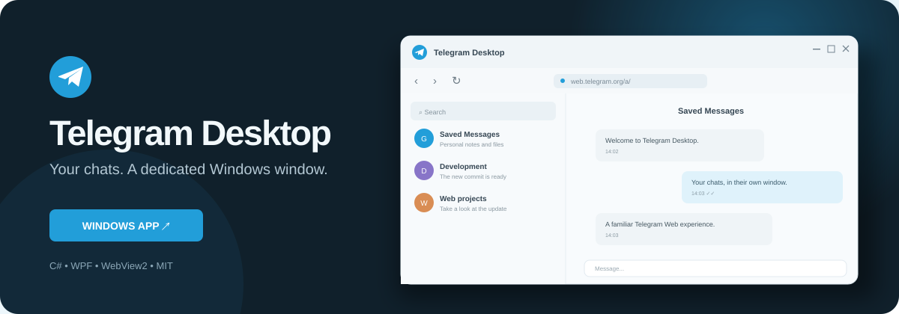
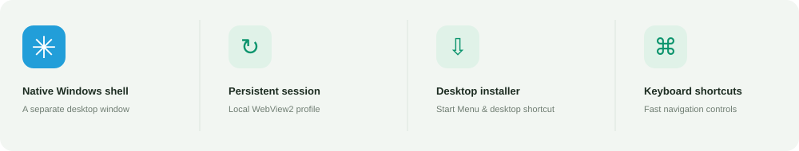

<div align="center">



# Telegram Desktop

**A focused desktop window for the official Telegram Web client.**

[](https://www.microsoft.com/windows)
[](https://dotnet.microsoft.com/)
[](https://learn.microsoft.com/dotnet/desktop/wpf/)
[](https://developer.microsoft.com/microsoft-edge/webview2/)
[](LICENSE)

[**Download for Windows**](https://github.com/German-GPD/Web-Desktop-App-Telegram/releases/latest/download/Telegram-Setup.exe) · [Website](https://german-gpd.github.io/Web-Desktop-App-Telegram/) · [Report an issue](https://github.com/German-GPD/Web-Desktop-App-Telegram/issues)

[English](#english) · [Русский](#русский) · [Español](#español)

</div>

---

<a id="english"></a>
## 🇬🇧 English

Telegram Desktop is an independent Windows application that opens the **official Telegram Web A client** in a dedicated desktop window. It combines a compact Windows-style shell with the familiar Telegram web experience.

> **Preview illustration:** the image below is a visual concept of the app window, not a screenshot of a live running build.



### ✨ Features

- **Windows-native feel** — a dedicated WPF desktop window, the original Telegram app mark and a compact navigation toolbar.
- **Official Telegram Web A** — loads [web.telegram.org/a/](https://web.telegram.org/a/); the Telegram service itself is not modified.
- **Persistent sign-in** — a dedicated WebView2 profile keeps website session data locally between launches.
- **Navigation controls** — reload and open-in-browser actions, plus keyboard navigation.
- **Verified updates** — checks GitHub Releases and verifies the installer SHA-256 checksum before offering an update.
- **Single instance** — a second launch activates the already-open window instead of opening another copy.
- **Keyboard shortcuts** — `Ctrl + R` / `F5` to reload, `Alt + ←` to go back, `Alt + →` to go forward.
- **Web features** — WebView2 handles downloads and website permission requests, including camera and microphone prompts.
- **Personal settings** — light, dark and system themes, website zoom, and configurable toolbar order and visibility.
- **Windows installer** — per-user installation (no administrator rights required), Start Menu and optional desktop shortcuts, plus an uninstaller.
- **One app icon** — the Telegram logo is used consistently by the app, installer, window and shortcuts.

### ⬇️ Download & install

<div align="center">

[](https://github.com/German-GPD/Web-Desktop-App-Telegram/releases/latest/download/Telegram-Setup.exe)

**[Download Telegram-Setup.exe](https://github.com/German-GPD/Web-Desktop-App-Telegram/releases/latest/download/Telegram-Setup.exe)**

</div>

1. Click **Download for Windows** or open the [Releases](https://github.com/German-GPD/Web-Desktop-App-Telegram/releases) page.
2. Download `Telegram-Setup.exe`.
3. Run the installer and follow the setup steps.
4. Launch Telegram Desktop and sign in at the official Telegram Web client.

The installer checks for Microsoft Edge WebView2 Runtime. If it is missing, it offers to open Microsoft's official download page. The app is launched automatically only when the runtime is detected.

### 🖥️ System requirements

| Component | Requirement |
|---|---|
| Operating system | Windows 10 (1809+) or Windows 11 |
| Architecture | x64 |
| Runtime | Microsoft Edge WebView2 Evergreen Runtime |
| Development | .NET 8 SDK and Inno Setup 6 |

WebView2 Runtime is a separate Microsoft component and is not bundled with this application.

### 🧰 Build from source

Clone the repository, install the requirements above, then run PowerShell from the project root:

```powershell
Set-ExecutionPolicy -Scope Process Bypass
.\scripts\build.ps1
```

Build outputs:

- `artifacts\publish\Telegram.exe` and `Telegram.ico` — portable publish folder.
- `artifacts\installer\Telegram-Setup.exe` — Windows installer.

The app is published as a self-contained .NET application. WebView2 Runtime must still be present on the target PC.

### 🏗️ Tech stack

- **C# / .NET 8**
- **WPF** — Windows desktop UI
- **Microsoft Edge WebView2** — embedded Telegram Web experience
- **Inno Setup 6** — Windows installer
- **GitHub Actions** — Windows CI build, checksums and release workflow

### 🔐 Privacy

The application is a desktop shell for the official Telegram website. It does not implement its own messaging service or bypass Telegram authentication.

- Website sign-in and session data are stored in the local WebView2 profile:
  `%LOCALAPPDATA%\GermanGPD\Telegram\WebView2`
- App settings are stored locally under `%LOCALAPPDATA%\GermanGPD\Telegram`.
- The app does not intentionally collect analytics or send telemetry.
- Do not share the WebView2 profile folder: it may contain active authentication/session data.
- Website content, account handling and service availability remain subject to Telegram's own policies and changes.

### 📦 Project links

- [Project website](https://german-gpd.github.io/Web-Desktop-App-Telegram/)
- [Releases](https://github.com/German-GPD/Web-Desktop-App-Telegram/releases)
- [Build workflow](https://github.com/German-GPD/Web-Desktop-App-Telegram/actions)
- [Issues & bug reports](https://github.com/German-GPD/Web-Desktop-App-Telegram/issues)

### ⚖️ Disclaimer & license

This is an independent community project by **German-GPD**. It is **not affiliated with, endorsed by, or sponsored by Telegram Messenger Inc.** Telegram is a trademark of its respective owner.

Released under the [MIT License](LICENSE).

---

<a id="русский"></a>
## 🇷🇺 Русский

**Telegram Desktop** — независимое приложение для Windows, которое открывает **официальный Telegram Web A** в отдельном окне рабочего стола. Привычный веб-клиент, аккуратная оболочка в стиле Windows и ничего лишнего.

> **Иллюстрация интерфейса:** изображение ниже — концептуальный макет окна приложения, а не скриншот запущенной сборки.


### ✨ Возможности

- **Стиль Windows** — отдельное WPF-окно, оригинальная иконка Telegram и компактная панель навигации.
- **Официальный Telegram Web A** — загружает [web.telegram.org/a/](https://web.telegram.org/a/); сам сервис Telegram не изменяется.
- **Сохранение входа** — отдельный профиль WebView2 хранит сессию сайта локально между запусками.
- **Навигация** — обновление страницы, открытие в браузере и клавиатурные сочетания.
- **Проверка обновлений** — приложение проверяет GitHub Releases и сверяет SHA-256 установщика перед предложением обновления.
- **Один экземпляр** — повторный запуск активирует уже открытое окно вместо создания второго.
- **Горячие клавиши** — `Ctrl + R` / `F5` — обновить, `Alt + ←` — назад, `Alt + →` — вперёд.
- **Возможности сайта** — WebView2 обрабатывает загрузки и запросы разрешений сайта, включая камеру и микрофон.
- **Настройки** — светлая, тёмная и системная темы, масштаб сайта, порядок и видимость кнопок панели.
- **Установщик Windows** — установка в профиль пользователя без прав администратора, меню «Пуск», необязательный ярлык на рабочем столе и деинсталлятор.
- **Одна иконка** — оригинальный знак Telegram используется в приложении, окне, установщике и ярлыках. Выбора других иконок нет.

### ⬇️ Скачать и установить

<div align="center">

[](https://github.com/German-GPD/Web-Desktop-App-Telegram/releases/latest/download/Telegram-Setup.exe)

**[Скачать Telegram-Setup.exe](https://github.com/German-GPD/Web-Desktop-App-Telegram/releases/latest/download/Telegram-Setup.exe)**

</div>

1. Нажми **Скачать для Windows** или открой страницу [Releases](https://github.com/German-GPD/Web-Desktop-App-Telegram/releases).
2. Скачай файл `Telegram-Setup.exe`.
3. Запусти установщик и следуй инструкциям.
4. Открой Telegram Desktop и войди через официальный Telegram Web.

Установщик проверяет наличие Microsoft Edge WebView2 Runtime. Если компонент отсутствует, он предложит открыть официальную страницу Microsoft. Приложение запускается автоматически только при обнаруженном runtime.

### 🖥️ Системные требования

| Компонент | Требование |
|---|---|
| Операционная система | Windows 10 (1809+) или Windows 11 |
| Архитектура | x64 |
| Runtime | Microsoft Edge WebView2 Evergreen Runtime |
| Для разработки | .NET 8 SDK и Inno Setup 6 |

WebView2 Runtime — отдельный компонент Microsoft, он не включён в приложение.

### 🧰 Сборка из исходного кода

Клонируй репозиторий, установи необходимые компоненты и запусти PowerShell в корневой папке проекта:

```powershell
Set-ExecutionPolicy -Scope Process Bypass
.\scripts\build.ps1
```

Результаты сборки:

- `artifacts\publish\Telegram.exe` и `Telegram.ico` — portable-папка приложения.
- `artifacts\installer\Telegram-Setup.exe` — установщик Windows.

Приложение публикуется как автономная .NET-программа. WebView2 Runtime всё равно должен быть установлен на целевом компьютере.

### 🏗️ Технологии

- **C# / .NET 8**
- **WPF** — интерфейс Windows-приложения
- **Microsoft Edge WebView2** — встроенный Telegram Web
- **Inno Setup 6** — установщик Windows
- **GitHub Actions** — автоматическая сборка, контрольные суммы и публикация релизов

### 🔐 Конфиденциальность

Приложение является оболочкой для официального сайта Telegram. Оно не создаёт собственный мессенджер и не обходит авторизацию Telegram.

- Данные входа и сессии сайта хранятся в локальном профиле WebView2:
  `%LOCALAPPDATA%\GermanGPD\Telegram\WebView2`
- Настройки приложения хранятся локально в `%LOCALAPPDATA%\GermanGPD\Telegram`.
- Приложение не предназначено для сбора аналитики или отправки телеметрии.
- Не передавай папку профиля WebView2 другим людям: в ней могут находиться данные активной сессии.
- Содержимое сайта, работа аккаунта и доступность сервиса регулируются правилами Telegram.

### 📦 Ссылки проекта

- [Сайт проекта](https://german-gpd.github.io/Web-Desktop-App-Telegram/)
- [Релизы](https://github.com/German-GPD/Web-Desktop-App-Telegram/releases)
- [Сборки GitHub Actions](https://github.com/German-GPD/Web-Desktop-App-Telegram/actions)
- [Сообщить об ошибке](https://github.com/German-GPD/Web-Desktop-App-Telegram/issues)

### ⚖️ Отказ от ответственности и лицензия

Это независимый проект **German-GPD**. Он **не связан с Telegram Messenger Inc., не одобрен и не спонсируется этой компанией**. Telegram является товарным знаком его владельца.

Лицензия: [MIT](LICENSE).

---

<a id="español"></a>
## 🇪🇸 Español

**Telegram Desktop** es una aplicación independiente para Windows que abre el **cliente oficial Telegram Web A** en una ventana de escritorio dedicada. Ofrece una experiencia web familiar con una interfaz limpia inspirada en Windows.

> **Ilustración de la interfaz:** la imagen es una representación conceptual de la ventana, no una captura de una versión en ejecución.


### ✨ Características

- **Estilo nativo de Windows** — ventana WPF, logotipo original de Telegram y barra de navegación compacta.
- **Telegram Web A oficial** — carga [web.telegram.org/a/](https://web.telegram.org/a/); el servicio web no se modifica.
- **Sesión persistente** — un perfil independiente de WebView2 conserva localmente la sesión entre ejecuciones.
- **Navegación** — recargar, abrir en el navegador y navegación con el teclado.
- **Actualizaciones verificadas** — comprueba GitHub Releases y verifica SHA-256 del instalador antes de ofrecer una actualización.
- **Instancia única** — una segunda ejecución activa la ventana abierta en lugar de abrir otra copia.
- **Atajos de teclado** — `Ctrl + R` / `F5` para recargar, `Alt + ←` para volver y `Alt + →` para avanzar.
- **Funciones web** — WebView2 gestiona descargas y solicitudes de permisos del sitio, como cámara y micrófono.
- **Configuración** — temas claro, oscuro y del sistema, zoom y controles de la barra superior.
- **Instalador de Windows** — instalación por usuario, accesos directos opcionales y desinstalador.
- **Un solo icono** — el logotipo de Telegram se utiliza en la aplicación, la ventana, el instalador y los accesos directos.

### ⬇️ Descargar e instalar

<div align="center">

[](https://github.com/German-GPD/Web-Desktop-App-Telegram/releases/latest/download/Telegram-Setup.exe)

**[Descargar Telegram-Setup.exe](https://github.com/German-GPD/Web-Desktop-App-Telegram/releases/latest/download/Telegram-Setup.exe)**

</div>

1. Haz clic en **Descargar para Windows** o abre la página de [versiones](https://github.com/German-GPD/Web-Desktop-App-Telegram/releases).
2. Descarga `Telegram-Setup.exe`.
3. Ejecuta el instalador y sigue los pasos.
4. Abre Telegram Desktop e inicia sesión en el cliente oficial Telegram Web.

El instalador comprueba si Microsoft Edge WebView2 Runtime está instalado y puede abrir la página oficial de Microsoft si falta. La aplicación solo se inicia automáticamente cuando el runtime está disponible.

### 🖥️ Requisitos del sistema

| Componente | Requisito |
|---|---|
| Sistema operativo | Windows 10 (1809+) o Windows 11 |
| Arquitectura | x64 |
| Runtime | Microsoft Edge WebView2 Evergreen Runtime |
| Desarrollo | .NET 8 SDK e Inno Setup 6 |

WebView2 Runtime es un componente independiente de Microsoft y no está incluido en la aplicación.

### 🧰 Compilar desde el código fuente

Clona el repositorio, instala los requisitos anteriores y ejecuta PowerShell desde la carpeta raíz del proyecto:

```powershell
Set-ExecutionPolicy -Scope Process Bypass
.\scripts\build.ps1
```

Archivos generados:

- `artifacts\publish\Telegram.exe` y `Telegram.ico` — carpeta portable.
- `artifacts\installer\Telegram-Setup.exe` — instalador de Windows.

La aplicación se publica como una aplicación .NET autónoma. WebView2 Runtime debe estar instalado en el equipo de destino.

### 🏗️ Tecnologías

- **C# / .NET 8**
- **WPF** — interfaz de escritorio para Windows
- **Microsoft Edge WebView2** — experiencia Telegram Web integrada
- **Inno Setup 6** — instalador de Windows
- **GitHub Actions** — compilación automatizada, checksums y publicaciones

### 🔐 Privacidad

La aplicación es una interfaz de escritorio para el sitio web oficial de Telegram. No implementa un servicio de mensajería propio ni evita la autenticación de Telegram.

- Los datos de sesión se almacenan localmente en el perfil de WebView2:
  `%LOCALAPPDATA%\GermanGPD\Telegram\WebView2`
- La configuración se guarda localmente en `%LOCALAPPDATA%\GermanGPD\Telegram`.
- La aplicación no está diseñada para recopilar analíticas ni enviar telemetría.
- No compartas la carpeta del perfil de WebView2: puede contener datos de autenticación.
- El contenido del sitio, las cuentas y la disponibilidad del servicio siguen sujetos a las políticas de Telegram.

### 📦 Enlaces del proyecto

- [Sitio web del proyecto](https://german-gpd.github.io/Web-Desktop-App-Telegram/)
- [Versiones](https://github.com/German-GPD/Web-Desktop-App-Telegram/releases)
- [Compilaciones](https://github.com/German-GPD/Web-Desktop-App-Telegram/actions)
- [Informar de un problema](https://github.com/German-GPD/Web-Desktop-App-Telegram/issues)

### ⚖️ Aviso legal y licencia

Este es un proyecto independiente de **German-GPD**. **No está afiliado, respaldado ni patrocinado por Telegram Messenger Inc.** Telegram es una marca registrada de su propietario.

Publicado bajo la [licencia MIT](LICENSE).

---

<div align="center">

**Made with care by [German-GPD](https://github.com/German-GPD)**

[Website](https://german-gpd.github.io/Web-Desktop-App-Telegram/) · [GitHub](https://github.com/German-GPD/Web-Desktop-App-Telegram) · [MIT License](LICENSE)

</div>